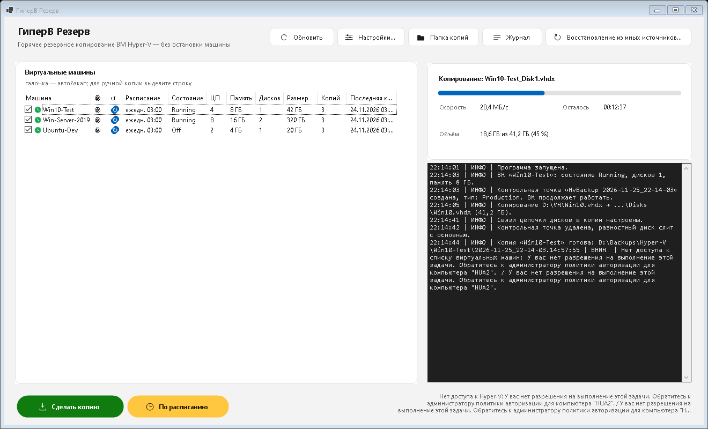
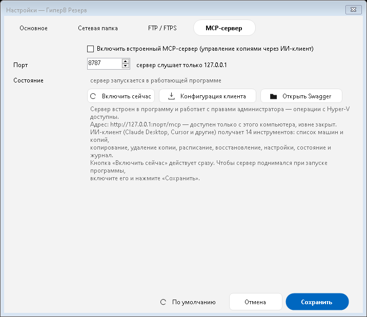
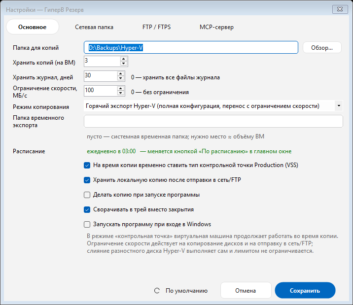
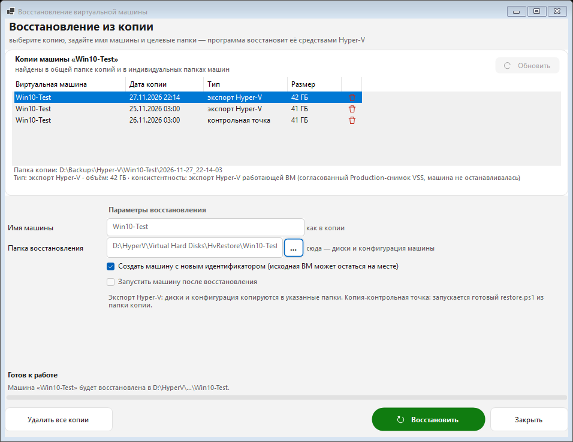
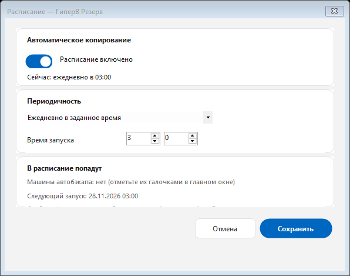

# ГиперВ Резерв 1.19

[](https://github.com/ZhenyaRUS39/HvBackup/actions/workflows/build.yml)

Горячее резервное копирование виртуальных машин Hyper-V **без остановки машины**:
контрольная точка → собственное копирование дисков с ограничением скорости → автоудаление старых копий.

---

## Возможности

| Что | Как |
|---|---|
| Копия без остановки ВМ | Контрольная точка Hyper-V **или** горячий экспорт: машина продолжает работать |
| **Полная конфигурация ВМ** | Режим «Горячий экспорт Hyper-V»: в копии лежит настоящий экспорт Hyper-V — восстановление одной командой `Import-VM` |
| Ограничение скорости | Своя копировальщица: средняя скорость не превышает заданный МБ/с |
| Ротация копий | Хранится N последних копий на каждую ВМ, самые старые удаляются сами |
| **Кнопка «По расписанию»** | Отдельная жёлтая кнопка: включение/отключение расписания и его периодичность |
| **Зелёный значок у ВМ** | Когда расписание активно, рядом с машиной горит зелёный значок с цикличностью копий |
| **Свои настройки у каждой ВМ** | Значок-шестерёнка у машины: свой график, своя папка копий, свой лимит скорости, свой режим копирования |
| **Сетевая папка (UNC)** | Дубликат копии на NAS/общую папку, с ротацией на месте |
| **FTP / FTPS** | Отправка копии на FTP-сервер (обычный FTP, FTPS с TLS), с ротацией на сервере |
| **Восстановление из окна программы** | Синяя кнопка-стрелка **↺** у каждой машины: восстановление из её собственных копий (все версии) — одна папка назначения |
| **Восстановление из иных источников** | Кнопка «Восстановление из иных источников…»: список всех найденных копий, включая копии удалённых машин |
| **Удаление копий** | Маленькое **красное ведро у каждой копии** в списке — удаляет именно эту копию; плюс кнопка «Удалить все копии» |
| **MCP-сервер встроен в программу** | Вкладка «Настройки → MCP-сервер»: кнопка включения/выключения, порт, адрес и готовая конфигурация клиента |
| **Управление копиями из ИИ-агента** | 14 инструментов: список машин и копий, копирование, удаление, расписание, восстановление, настройки, журнал |
| **Swagger с описаниями** | Тот же набор операций в виде REST-API с документацией: `http://127.0.0.1:8787/swagger` |
| Восстановление вручную | В каждой копии лежит готовый `restore.ps1` |
| Фоновый режим | Сворачивается в трей, автозапуск при входе в Windows |
| **Оформление Windows 11** | Скруглённые карточки и кнопки, овальные вкладки, зелёная кнопка «Сделать копию», светлая/тёмная тема по системной |

## Требования

* Windows 10/11 с ролью Hyper-V.
* Права администратора (программа сама запрашивает повышение при запуске).
* .NET 8 Desktop Runtime — на этой машине уже установлен (8.0.21).

## Запуск

1. Скопируйте `HvBackup.exe` в любую папку (например `C:\Tools\HvBackup`).
2. Запустите — появится запрос UAC.
3. **Для ручной копии** выделите нужную машину в списке (Ctrl/Shift — несколько машин) и нажмите
   **«Сделать копию»** (зелёная кнопка внизу). Галочки для этого не нужны.
4. **Галочка** у машины означает одно: она включена в **автобэкап**. Такие машины копируются
   по расписанию — его настраивает жёлтая кнопка **«По расписанию»**.

## Скриншоты



*Главное окно: список виртуальных машин, прогресс копирования и журнал.*



*Вкладка «MCP-сервер» в настройках: встроенный сервер управления копиями
для ИИ-клиентов (Claude Desktop, Cursor и другие) — 14 инструментов, порт и
адрес для подключения.*



*Основные настройки: хранилище, ротация копий, режим копирования.*



*Восстановление из иных источников.*



*Настройка расписания автоматических копий.*

---

## Интерфейс

Оформление сделано в стиле Windows 11 и рисуется собственным кодом (без внешних библиотек):

* **Главное окно** — шапка с кнопками «Обновить», «Настройки…», «Папка копий», «Журнал»,
  **«Восстановление из иных источников…»**; слева карточка со списком виртуальных машин,
  справа карточка состояния копии (прогресс, скорость, остаток времени, объём) и тёмная
  карточка журнала.
* **Зелёная кнопка «Сделать копию»** — разовое копирование **выделенной в списке машины**
  (одной или нескольких — Ctrl/Shift). Галочки для этого не нужны: они означают только
  участие в автобэкапе. Рядом — красная «Остановить», она появляется, когда копия идёт.
* **Галочка в списке = автобэкап.** Машины с галочкой копируются по расписанию
  (жёлтая кнопка «По расписанию») и при запуске программы, если включён соответствующий
  пункт. Выделение строки (рамка) — это выбор для ручной копии; после обновления списка
  выделение сохраняется.
* **Жёлтая кнопка «По расписанию»** — отдельное окно настроек автоматических копий:
  переключатель «Расписание включено», периодичность (каждые N минут / ежедневно в HH:mm /
  еженедельно в день и время), список машин, которые попадут в расписание, и время
  следующего запуска. Там же расписание **отключается** — одним переключателем.
  Время запуска для каждой машины считается один раз и запоминается: копирование
  начинается, когда подходит это время. Если программа была выключена или компьютер
  спал в это время, копирование запускается при первом запуске программы — с пропущенного
  времени, а не со следующего дня.
* **Зелёный значок у виртуальной машины** — когда расписание активно, рядом с названием
  машины появляется зелёный значок, а в колонке «Расписание» — цикличность копий
  («60 мин», «ежедн. 03:00», «пн 03:00»). Значок есть только у машин, отмеченных
  галочками: они и копируются по расписанию. Подсказка показывает полный текст.
* **Список машин** — состояние, ЦП, память, число дисков, **размер ВМ** (суммарный объём
  виртуальных дисков, как их видит гостевая ОС), число копий и дата последней копии.
* **Значок-шестерёнка ⚙ у каждой машины** — клик по нему открывает окно
  **индивидуальных настроек этой ВМ**: свой график, своя папка копий, свой лимит скорости,
  свой режим копирования и свои адреса хранилищ. Всё, что не задано для ВМ,
  берётся из общих настроек программы.
* **Синяя кнопка ↺ у каждой машины** — клик открывает **восстановление этой машины из её
  копий**: окно сразу со всеми версиями её копий, свежайшая выбрана, имя подставлено.
  В подсказке строки — сколько копий и когда самая свежая.
* **Настройки** — три вкладки-переключателя («Основное», «Сетевая папка», «FTP / FTPS»),
  скруглённые поля ввода с подсветкой при фокусе. Расписание здесь только показывается
  строкой-подсказкой — меняется оно кнопкой «По расписанию».
* **Кнопка «Восстановление из иных источников…»** — окно восстановления из **произвольной**
  копии (описание ниже, раздел «Восстановление»). Пока идёт копирование, кнопка недоступна:
  сначала дождитесь окончания копии.
* Тема (светлая/тёмная) подхватывается из системной настройки
  (`AppsUseLightTheme`), шрифт — Segoe UI Variable, если он установлен.

Окно на Windows 11 дополнительно скругляется средствами DWM
(`DWMWA_WINDOW_CORNER_PREFERENCE`); на Windows 10 остаётся системная рамка.

## Настройки

| Параметр | Смысл |
|---|---|
| **Папка для копий** | Куда складывать. Внутри создаётся подпапка на каждую ВМ: `<папка>\<ВМ>\<дата-время>\` |
| **Хранить копий (на ВМ)** | Сколько последних копий оставлять; остальные удаляются после каждой новой |
| **Хранить журнал, дней** | Сколько дней хранить файлы журнала. Старые файлы (`log-ГГГГ-ММ.txt`) удаляются при запуске программы и после сохранения настроек. `0` — хранить всё |
| **Ограничение скорости, МБ/с** | Потолок скорости копирования дисков. `0` — без ограничения |
| **Режим копирования** | Три варианта — см. раздел «Режимы копирования» ниже |
| **Папка временного экспорта** | Куда Hyper-V выгружает ВМ на время копии в режиме «Горячий экспорт». Пусто — системная временная папка. Нужно свободное место ≈ объёму ВМ |
| **Периодичность** | Расписание автоматических копий — задаётся жёлтой кнопкой «По расписанию» в главном окне |
| **Production-контрольная точка** | На время копии тип точки временно переключается в Production (VSS): согласованность на уровне приложений и **не расходует память ВМ**. Исходное значение возвращается автоматически |
| **Хранить локальную копию** | Если выключено, локальная копия удаляется после успешной отправки в сеть/FTP (экономит место; если отправка не удалась — копия остаётся) |
| **Автозапуск при входе в Windows** | Создаётся задача Планировщика (от SYSTEM, с повышенными правами) |
| **MCP-сервер** (вкладка «MCP-сервер») | Встроенный сервер управления копиями для ИИ-клиентов: вкл/выкл, порт, адрес, готовая конфигурация клиента — см. раздел «MCP-сервер и Swagger» |

### Дополнительные хранилища (вкладки «Сетевая папка» и «FTP»)

Копия всегда сначала делается локально (это быстрый рабочий каталог), потом **зеркалируется**
в сетевую папку и/или на FTP. Структура на удалённой стороне повторяет локальную:

```
<сетевая папка или каталог FTP>\<ВМ>\<дата-время>\
├── Disks\        файлы виртуальных дисков
├── vm-info.json
├── restore.ps1
└── README.txt
```

* **Сетевая папка** — путь вида `\\nas\backups\Hyper-V`. Можно указать пользователя и пароль;
  подключение выполняется через Windows (с учётными данными программы или пользователя).
  Кнопка **«Проверить подключение»** создаёт и удаляет пробную папку.
* **FTP / FTPS** — адрес, порт, пользователь, пароль, каталог на сервере.
  Поддерживается обычный FTP, FTPS с `AUTH TLS` и неявный FTPS (обычно порт 990).
  Пассивный режим — по умолчанию (активный тоже есть). Кнопка **«Проверить подключение»**.
* **Ротация работает на всех сторонах**: и локально, и в сетевой папке, и на FTP — лишние
  старые копии удаляются сами.
* **Пароли** хранятся в настройках не открытым текстом, а зашифрованными средствами Windows
  (DPAPI, машинный уровень) — их нельзя прочитать из файла настроек.

## Индивидуальные настройки виртуальных машин

У каждой машины в списке есть значок-шестерёнка ⚙ (колонка рядом с названием).
Клик по нему открывает окно настроек **только этой ВМ**. Таким образом можно, например,
копировать «тяжёлую» машину ночью и медленно (10 МБ/с), а лёгкую — часто и быстро,
и при этом всё это в одном окне.

В окне есть главный переключатель **«Применять отдельные настройки к этой машине»**:

* пока он снят — ВМ использует общие настройки программы (как все остальные);
* когда включён — открываются поля ниже, и то, что в них задано, действует **только
  на эту ВМ**; остальное по-прежнему берётся из общих настроек;
* кнопка **«Вернуть общие»** полностью удаляет индивидуальные настройки этой ВМ.

Что можно задать отдельно для ВМ:

| Параметр | Смысл |
|---|---|
| **Автобэкап для этой машины** | Та же галочка, что и в списке: машина участвует в копировании по расписанию |
| **Свой график копирования** | Каждые N минут / ежедневно в HH:mm / еженедельно в день и время — отдельно от общего расписания |
| **Папка для копий** | Своя папка именно для этой ВМ |
| **Хранить копий** | Своё число копий (ротация) для этой ВМ |
| **Ограничение скорости, МБ/с** | Свой лимит скорости для этой ВМ |
| **Режим копирования** | Свой режим: горячий экспорт / контрольная точка + своё копирование / прямой экспорт |
| **Production-контрольная точка** | Свой выбор для этой ВМ |
| **Хранить локальную копию** | Своё поведение после отправки в сеть/FTP |
| **Сетевая папка** | Свой путь UNC для этой ВМ |
| **Каталог FTP** | Свой каталог на FTP-сервере для этой ВМ |

Что остаётся общим для всех машин (сознательно): логин/пароль и режим TLS для
сетевой папки и FTP, а также срок хранения журнала.

Расписание считается для каждой ВМ отдельно: программа сама выбирает ближайший
из всех графиков и запускает копирование тех машин, которым «пора». У ВМ с собственным
графиком в колонке «Расписание» показывается именно её график.

Индивидуальные настройки хранятся в общем файле настроек программы
(`%ProgramData%\HvBackup\settings.json`) в отдельном разделе `PerVm`.

## Режимы копирования

В настройках выбирается один из трёх режимов. Все три работают **без остановки ВМ**.

### 1. Горячий экспорт Hyper-V (по умолчанию) — полная конфигурация

Работающая машина выгружается штатным механизмом Hyper-V:

1. `Export-VM -CaptureLiveState CaptureDataConsistentState` — Hyper-V снимает согласованный
   Production-снимок (VSS) и выгружает **конфигурацию машины и диски**. Машина при этом
   не останавливается и не ставится на паузу.
2. Готовая копия переносится в папку копий **нашей копировальщицей — с ограничением скорости**
   (поэтому режим требует свободного места под временный экспорт; его можно перенести
   на другой диск настройкой «Папка временного экспорта»).
3. Временная папка удаляется.

В копии лежит **настоящий экспорт Hyper-V** (`Virtual Hard Disks\`, `Virtual Machines\`,
`Snapshots\`) — восстановление одной командой:

```powershell
# PowerShell от имени администратора
Import-VM -Path 'D:\Backups\Hyper-V\Win10\2026-11-26_03-00-00'
Start-VM -Name 'Win10'
```

Так возвращаются **все** настройки машины: Secure Boot, TPM, все сетевые адаптеры, DVD-приводы,
COM-порты, интеграционные компоненты, порядок контроллеров дисков — то, что не переносит
наш собственный `restore.ps1`.

> **Цена режима:** данные копируются дважды — сначала Hyper-V (на полной скорости, во временную
> папку) и затем нашей копировальщицей с лимитом. Нужно свободное место ≈ объёму ВМ во временной папке.
> Отмена во время экспорта невозможна (Hyper-V не умеет прерывать экспорт) — программа дожидается
> его завершения, показывая «Завершение…».

### 2. Контрольная точка + своё копирование

Наш прежний режим: контрольная точка → копирование цепочки дисков с ограничением скорости →
починка связей дисков → `restore.ps1`. Копия компактнее (только диски и метаданные),
скорость ограничена на самом копировании, но конфигурация машины переносится **частично**
(память, ЦП, поколение, коммутатор, MAC, контроллеры дисков).

### 3. Прямой экспорт Hyper-V (быстро)

То же, что режим 1, но без промежуточной папки и без ограничения скорости: Hyper-V сразу пишет
копию в папку копий. Минимум места и времени, копия — полноценный экспорт для `Import-VM`.

## Как устроен процесс копирования

Описание ниже — для режима «Контрольная точка + своё копирование». В режимах экспорта
процесс такой: `Export-VM` (согласованный Production-снимок) → перенос копии в папку копий
(с ограничением скорости или без) → ротация.

1. Снимается **контрольная точка** ВМ (машина при этом работает).
2. Определяется цепочка виртуальных дисков. У работающей машины активный диск в этот момент меняется,
   поэтому копируются «замороженные» предки — их содержимое соответствует моменту снятия точки.
3. Файлы копируются **с ограничением скорости** в `<папка>\<ВМ>\<дата-время>\Disks\`.
4. В копии перенастраиваются связи цепочки дисков (`Set-VHD -ParentPath`), чтобы она была самодостаточной.
5. Пишутся `vm-info.json`, `restore.ps1`, `README.txt`.
6. Контрольная точка удаляется — Hyper-V сливает разностный диск с основным (в фоновом потоке,
   программа в это время не замирает и показывает текущий шаг).
7. Лишние старые копии удаляются.

Для выключенной ВМ контрольная точка не нужна — диски копируются напрямую.

## Что внутри копии

Режим «Контрольная точка + своё копирование»:

```
<папка>\<ВМ>\2026-11-25_22-30-00\
├── Disks\          файлы виртуальных дисков (копия цепочки)
├── vm-info.json    параметры ВМ: память, ЦП, ключ, MAC, пути, контроль
├── restore.ps1     скрипт восстановления
└── README.txt      краткая памятка
```

Режимы экспорта (папка — полноценный экспорт Hyper-V):

```
<папка>\<ВМ>\2026-11-25_22-30-00\
├── Virtual Hard Disks\   виртуальные диски (слитая цепочка)
├── Virtual Machines\     конфигурация ВМ (.vmcx/.vmrs)
├── Snapshots\            контрольные точки, если были
├── vm-info.json          параметры исходной ВМ для справки
└── README.txt            памятка: как восстановить через Import-VM
```

Лишние `README.txt` и `vm-info.json` в корне экспорта Hyper-V игнорирует — для импорта
достаточно трёх стандартных папок.

## Восстановление

### Восстановление машины из её копий — кнопка ↺ в строке

У каждой виртуальной машины в списке есть **синяя кнопка-стрелка ↺** — восстановление
этой машины из её собственных копий.

1. Нажмите **↺** у нужной машины. Пока идёт копирование, кнопка недоступна:
   сначала дождитесь окончания копии.
2. Откроется окно **сразу с копиями этой машины**: заголовок «Копии машины «…»»,
   свежайшая копия выбрана, имя машины подставлено. В списке — **все версии копий**
   (дата, тип, объём); выберите ту, из которой восстанавливать.
3. Задайте **одну** целевую папку и, если нужно, имя:

   | Поле | Смысл |
   |---|---|
   | **Имя машины** | Под каким именем машина появится в Hyper-V. По умолчанию — как в копии |
   | **Папка восстановления** | Один путь на всю машину. Внутри программа сама разложит диски и конфигурацию: для экспорта — `Virtual Hard Disks` и `Virtual Machines`, для копии-контрольной точки — сама папка (скрипт сам создаёт `Disks`) |
   | **Новый идентификатор** | По умолчанию включено: машина создаётся с новым ID, исходная ВМ может остаться на месте |
   | **Запустить после восстановления** | По умолчанию выключено |

4. Нажмите **«Восстановить»**. Видно ход работы: при импорте экспорта — объём
   скопированных дисков и скорость, при восстановлении из контрольной точки —
   общий неопределённый прогресс (его скорость ограничить нельзя).
5. После успеха список машин в главном окне обновляется.

### Восстановление из иных источников — кнопка «Восстановление из иных источников…»

Отдельный путь для копии, которая не лежит в папке машин (например, принесённая
с другого компьютера): кнопка **«Восстановление из иных источников…»** в шапке главного окна
(в меню значка в трее — то же название). Окно открывается
со **всеми** найденными копиями, включая копии машин, которых больше нет в Hyper-V.

Программа ищет копии:
* в общей папке копий и в индивидуальных папках машин (из настроек ВМ);
* **включая копии машин, которых больше нет в Hyper-V** — их как раз и нужно восстанавливать.

Что важно знать:

* **Удаление копий.** У **каждой строки копии** в списке стоит маленькое **красное ведро**:
  нажатие удаляет именно эту копию (работает и клавиша **Del** в списке). Внизу окна —
  кнопка **«Удалить все копии»** — удаляет все показанные копии. Обе операции спрашивают
  подтверждение и показывают, что именно будет удалено: машина, дата, объём, папка.
  Перед удалением папка копии переименовывается (чтобы её нельзя было случайно выбрать
  ещё раз), затем стирается. Действие необратимо — восстановить из удалённой копии
  машину уже не получится.
* **Копии подхватываются сразу.** Колонка «Копий» в главном окне, счётчик в подсказке
  строки и список в окне восстановления считаются по одним и тем же папкам.
  Проверить, что программа видит, можно командой `HvBackup.exe --copies` — она печатает
  все найденные копии с типом и объёмом.
* **Вложенный экспорт распознаётся.** При горячем экспорте Hyper-V складывает
  «Virtual Machines» и «Virtual Hard Disks» в подпапку с именем машины
  (`<копия>\<ВМ>\Virtual Hard Disks\…`) — программа находит её и импортирует именно её.
* **Имя проверяется заранее.** Если машина с таким именем уже есть, программа сообщит об
  этом понятной фразой и предложит другое имя — вместо ошибки Hyper-V.
* **Целевая папка должна быть свободна.** Если в ней уже есть файлы, программа подберёт
  свободную папку рядом (`…_2`) и напишет об этом в журнал: Hyper-V не копирует диски
  поверх существующих файлов.
* **Восстановление из экспорта** — это `Import-VM -Copy -GenerateNewId` плюс `Rename-VM`:
  файлы копируются в целевые папки, машина получает новый идентификатор, имя задаёте вы.
  Существующие машины не трогаются.
* **Восстановление из копии-контрольной точки** запускает готовый `restore.ps1` из папки
  копии: он копирует диски, чинит цепочку и создаёт машину с исходными параметрами.
  Скрипты, сделанные программой до 1.13, не умеют принимать имя — тогда машина создаётся
  с исходным именем и переименовывается сразу после восстановления.
* **Отмена.** Пока идёт восстановление, окно можно закрыть — программа спросит подтверждение.
  Прерванная копия дисков может остаться в целевой папке.
* Исходная копия при восстановлении **не удаляется**.

### Вручную — PowerShell от имени администратора

Для экспорта Hyper-V (режимы 1 и 3):

```powershell
# PowerShell от имени администратора
Import-VM -Path 'D:\Backups\Hyper-V\Win10\2026-11-25_22-30-00'
Start-VM -Name 'Win10'
```

Импорт невозможен, пока существует ВМ с тем же идентификатором — такую машину нужно
предварительно переименовать или удалить. Окно восстановления делает это само:
создаёт машину с новым идентификатором (`-Copy -GenerateNewId`), а имя задаёте вы.

**Что именно попадает в копию работающей машины.** В режимах экспорта для работающей ВМ
используется `Export-VM -CaptureLiveState CaptureDataConsistentState` — это Production-технология
Hyper-V: снимается согласованный (VSS) снимок дисков. Машина при этом **не останавливается
и не ставится на паузу**. У такого снимка есть два следствия, о которых надо знать:

* **Состояние памяти не сохраняется.** Только режим `CaptureSavedState` сохраняет ОЗУ;
  в нашем режиме в копии лежат диски и конфигурация, поэтому восстановленная машина
  запускается как после включения питания, а не «продолжает» с того же места.
* **Данные — на момент снимка.** Всё, что гостевая ОС записала после снятия снимка,
  в копию не попадает (так же, как у любой контрольной точки).

Для режима «Контрольная точка + своё копирование»:

```powershell
# PowerShell от имени администратора
cd D:\Backups\Hyper-V\Win10\2026-11-25_22-30-00
.\restore.ps1 -Destination D:\Restore\Win10 -Start
```

* `-Destination` — куда развернуть (по умолчанию `D:\Restore\<имя ВМ>`).
* `-VmName` — имя восстанавливаемой машины (в копиях, сделанных программой 1.13 и новее).
* `-Start` — сразу запустить восстановленную машину.
* `-Flatten` — дополнительно слить цепочку дисков в один VHDX (долгая операция).

Скрипт сам копирует диски, чинит связи цепочки, создаёт ВМ с исходными параметрами
(поколение, память, число ЦП, ключ, MAC-адрес) и подключает все её виртуальные диски
(дополнительные — командой `Add-VMHardDiskDrive` с теми же номерами контроллера).

## Важно знать

* **Контрольная точка снимается и снимается автоматически.** Пока копируются диски, запись в ВМ идёт
  в разностный диск — следите за свободным местом на диске самой ВМ.
* **Кнопка «Остановить» отменяет копирование, но не уборку.** После отмены программа всё равно
  удаляет контрольную точку (сливает разностный диск) и возвращает исходный тип точки —
  это занимает от нескольких секунд до минуты. Кнопка в это время показывает «Завершение…»,
  а журнал пишет, что именно происходит. Прервать этот этап нельзя: иначе ВМ осталась бы
  с неверным типом контрольной точки.
* **Во время уборки окно не замирает.** Снятие и удаление контрольной точки, возврат типа точки
  и экспорт ВМ выполняются в фоновом потоке: программа остаётся отзывчивой, фаза в карточке
  справа обновляется в реальном времени, окно можно двигать, а журнал пишет текущий шаг.
* **После завершения надпись фазы и полоса прогресса очищаются.** Поздние сообщения
  от уже закончившейся копии отбрасываются — надпись «Возврат исходного типа контрольной точки»
  не может остаться висеть на экране (так же и «значок» — бегущая анимация полосы).
* **Слияние разностного диска Hyper-V делает сам и скорость не ограничивает** — этот этап может занять время.
* **В карточке справа всегда видно ход копирования:** скорость, оставшееся время и объём.
  Во время горячего экспорта Hyper-V программа следит за папкой экспорта и показывает,
  сколько уже выгружено и с какой скоростью идёт выгрузка (общий объём известен примерно —
  по объёму дисков ВМ, поэтому он помечен знаком «≈»). При переносе копии в папку копий
  скорость и оставшееся время обновляются несколько раз в секунду.
* **Экспорт Hyper-V тоже не умеет ограничивать скорость.** Ограничение применяется к переносу
  готовой копии в папку копий (и в сеть/FTP). Сам `Export-VM` Hyper-V пишет на максимуме —
  иначе не получилось бы ограничить скорость готовой копии.
* **Это полная копия, не инкрементальная.** Время копирования ≈ объём дисков ÷ лимит скорости.
  В сеть и FTP копия уходит **второй раз** — тоже с ограничением скорости.
* **Согласованность:** если удалось снять Production-точку (VSS) — данные согласованы на уровне приложений;
  иначе копия согласована на уровне дисков (crash-consistent), как и любой обычный снимок.
* **Шифрования и дедупликации нет** — копия занимает столько же места, сколько диски ВМ.
* Восстановление из копии — **отдельная операция** (кнопка «Восстановить» в окне
  восстановления), автоматической
  замены ВМ программа не делает. Исходная машина при восстановлении не удаляется и не меняется.
* Если сеть или FTP недоступны — копия остаётся локально, а ошибка пишется в журнал.

## MCP-сервер и Swagger

MCP-сервер **встроен в программу** — отдельного `HvBackup.Mcp.exe` больше нет.
Сервер запускается и останавливается кнопкой в настройках
(**«Настройки…» → вкладка **«MCP-сервер»**), слушает **только 127.0.0.1** и работает
с теми же правами администратора, что и сама программа, — поэтому операции с Hyper-V
(список машин, копирование, восстановление) доступны без дополнительных запросов UAC.

Что есть на вкладке «MCP-сервер»:

* **галочка «Включить встроенный MCP-сервер»** и **порт** (по умолчанию 8787);
* кнопка **«Включить сейчас» / «Выключить сейчас»** — работает сразу, без закрытия окна;
* кнопка **«Конфигурация клиента»** — кладёт в буфер обмена готовый фрагмент для MCP-клиента;
* кнопка **«Открыть Swagger»** — документация прямо в браузере;
* строка **«Состояние»**: «работает: http://127.0.0.1:8787/mcp» или «выключен».

Если сервер включён и настройка сохранена, он поднимается автоматически при запуске
программы. В строке состояния главного окна и в меню трея показан его адрес.

### Транспорты

| Транспорт | Адрес | Что это |
|---|---|---|
| **MCP поверх HTTP** | `POST http://127.0.0.1:8787/mcp` | JSON-RPC 2.0, ответ приходит в теле запроса — основной путь для ИИ-клиентов |
| **MCP через SSE** | `GET http://127.0.0.1:8787/mcp` | Поток событий: сервер отдаёт адрес для сообщений, ответы приходят в поток |
| **REST + Swagger** | `http://127.0.0.1:8787/swagger` | Тот же набор операций для человека: описания и кнопка «Выполнить» |
| **MCP (stdio)** | `HvBackup.exe --mcp` | JSON-RPC через стандартный ввод/вывод — для клиентов, которые сами запускают программу |

### Подключение к MCP-клиенту

Готовый фрагмент (его можно взять кнопкой «Конфигурация клиента»):

```json
{
  "mcpServers": {
    "hvbackup": {
      "type": "http",
      "url": "http://127.0.0.1:8787/mcp"
    }
  }
}
```

Для клиентов, у которых HTTP-транспорта нет, — запуск программы как дочернего процесса:

```json
{
  "mcpServers": {
    "hvbackup": {
      "command": "C:\\Tools\\HvBackup\\HvBackup.exe",
      "args": ["--mcp"]
    }
  }
}
```

> В этом варианте клиент запускает `HvBackup.exe` сам, а тот запрашивает повышение прав (UAC).
> Встроенный HTTP-сервер работает уже внутри запущенной программы и UAC не спрашивает —
> поэтому HTTP-вариант предпочтительнее.

### Swagger

* `http://127.0.0.1:8787/swagger` — страница с описаниями всех операций; у каждой есть
  кнопка **«Выполнить»**, которая вызывает API прямо из браузера.
* `http://127.0.0.1:8787/swagger/v1/swagger.json` — документ **OpenAPI 3.0** (импортируется
  в Postman, Swagger Editor и другие инструменты).
* `http://127.0.0.1:8787/health` — проверка, что сервер работает.

Страница Swagger полностью автономна: интернет и внешние скрипты не нужны.

### Инструменты (14)

| Инструмент | Что делает |
|---|---|
| `list_vms` | Список виртуальных машин Hyper-V |
| `list_backups` | Список копий (можно отфильтровать по машине) |
| `create_backup` | Сделать горячую копию (по умолчанию — в фоне, с заданием) |
| `delete_backup` | Удалить конкретную копию (папкой или парой «машина + дата») |
| `delete_all_backups` | Удалить все копии машины |
| `get_schedule` | Показать расписание (общее и своё у машины) |
| `set_schedule` | Изменить время/периодичность копирования |
| `restore_backup` | Восстановить машину из копии |
| `get_settings` | Показать настройки программы |
| `update_settings` | Изменить настройки (папка копий, число копий, лимит скорости, режим…) |
| `get_status` | Состояние программы и доступ к Hyper-V |
| `get_logs` | Последние строки журнала |
| `get_job` / `list_jobs` | Состояние и список фоновых операций |

У каждого инструмента — **описание на русском** и **JSON Schema** параметров, поэтому
агент понимает их без дополнительных подсказок.

### Что важно знать

* **Сервер встроен в программу.** Отдельного `HvBackup.Mcp.exe` больше нет: MCP-сервер
  поднимается внутри работающей программы (кнопка на вкладке «MCP-сервер») и потому
  сразу имеет права администратора. Без них операции с Hyper-V вернут понятную ошибку
  («Нет прав доступа к Hyper-V…»), а не упадут.
* **Права администратора.** Настройки сервер читает и меняет без повышения прав, но
  операции с Hyper-V (список машин, копирование, восстановление) требуют прав администратора.
  Сам GUI всё равно запускается с повышением прав — как и раньше.
* **Настройки видны сразу.** Если через MCP поменять расписание или папку копий,
  работающая программа подхватит изменение сама (в течение секунды) — файл настроек
  читается заново.
* **Копирование в фоне.** `create_backup` возвращает `jobId`; состояние смотрится
  через `get_job`. С параметром `wait=true` вызов дождётся окончания копии.
* **Удаление необратимо** — ровно как в окне программы.
* Сервер слушает **только 127.0.0.1** — снаружи он недоступен.

## Служебные режимы

```
HvBackup.exe --selftest   самопроверка (троттлинг, ротация, расписание, сценарии, FTP в петле, поздние обновления прогресса, MCP-сервер)
HvBackup.exe --listvms    список ВМ с параметрами
HvBackup.exe --copies     список найденных копий, пригодных для восстановления
HvBackup.exe --version    версия
HvBackup.exe --preview файл.png [--dark] [--settings] [--mcp-tab] [--schedule] [--vm] [--restore]   снимок окна в PNG (предпросмотр оформления)
HvBackup.exe --preview файл.png --copy   снимок окна в момент настоящего копирования (проверка показателей)

HvBackup.exe --mcp                       MCP-сервер в режиме stdio (JSON-RPC через stdin/stdout)
HvBackup.exe --mcp-http [--port N]       MCP-сервер в режиме HTTP (REST + Swagger + /mcp) без окна программы
```

## Журнал

`%ProgramData%\HvBackup\log-ГГГГ-ММ.txt` — подробный журнал всех операций.
Кнопка **«Открыть журнал»** в главном окне.

Срок хранения задаётся в настройках («Хранить журнал, дней», по умолчанию 30 дней,
`0` — хранить всё). Старые файлы журнала удаляются автоматически при запуске программы
и сразу после сохранения настроек; в журнал пишется, сколько файлов удалено.

## Настройки и автозапуск

Настройки: `%ProgramData%\HvBackup\settings.json` (создаётся при первом запуске).
Папка выбрана общую системную, потому что задача Планировщика запускает программу от SYSTEM —
у него своя пользовательская папка, и настройки были бы не видны. Старые настройки из
`%APPDATA%\HvBackup\settings.json` переносятся автоматически.

## Сборка из исходников

Проект один — `HvBackup.csproj`; MCP-сервер лежит в папке `Mcp\` внутри него и собирается вместе с программой.

```powershell
dotnet publish HvBackup.csproj -c Release -r win-x64 --self-contained false `
  -p:PublishSingleFile=true -p:IncludeNativeLibrariesForSelfExtract=true
```

Самопроверка без установки Hyper-V:

```powershell
dotnet publish HvBackup.csproj -c Release -p:NoElevation=true -o out
out\HvBackup.exe --selftest
```
